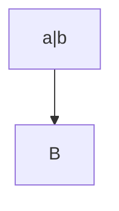

# セルの中に複雑な Markdown がある表の見本

`mdtable convert`（パイプ表と HTML の表の切り替え）と、Excel との往復を確かめるための見本です。表を 1 つずつ変えて戻し、GitLab の描画を前後で比べます。見出しの先頭の番号（`P01` など）が、見本の番号です。結果は検証記録にあります。

- `P`: パイプ表のセル
- `H`: HTML の表のセル。パイプ表に書けない中身（コードブロック・タスク・引用・見出し・結合など）は、変えずに断るのが正しい結果
- `C`: リストと引用の中の表
- `R`: HTML の表のセルに、空行をはさまずに書いた Markdown のリンクの形（GitLab は、リンクと画像だけを描画する）
- `X`: Excel のセルに入れる Markdown（表ではなく、入れる文字をコードブロックで示す）

## パイプ表のセル

### P01 強調の組み合わせ

| 項目 | 中身 |
| --- | --- |
| P01 | **太字** と *斜体* と ~~取り消し~~ と ***両方*** と **太字の中の `code` と [リンク](https://example.com/a)** |

### P02 下線の強調と語中の記号

| 項目 | 中身 |
| --- | --- |
| P02 | _斜体_ と __太字__ と snake_case_name と 2*3*4 と a~b~c |

### P03 コードスパンの中の縦棒とバッククォート

| 項目 | 中身 |
| --- | --- |
| P03 | `a \| b` と `x \|\| y` と `` `バッククォート` 入り `` と ` 前後に空白 ` |

### P04 コードスパンの中の HTML と記号

| 項目 | 中身 |
| --- | --- |
| P04 | `<br>` と `<td>` と `**強調しない**` と `$x$` と `[リンクではない](x)` |

### P05 リンク各種

| 項目 | 中身 |
| --- | --- |
| P05 | [題付き](https://example.com/a "題") と <https://example.com/b> と https://example.com/c_d と [参照][ref] と [ref] |

### P06 画像

| 項目 | 中身 |
| --- | --- |
| P06 |  と [](https://example.com/link) |

### P07 改行の 3 つの書き方

| 項目 | 中身 |
| --- | --- |
| P07 | 1 行目<br>2 行目<br/>3 行目<br />4 行目 |

### P08 強調をまたぐ改行

| 項目 | 中身 |
| --- | --- |
| P08 | **太字<br>の続き** と *斜体<br>の続き* |

### P09 リスト

| 項目 | 中身 |
| --- | --- |
| P09 | <ul><li>項目 1</li><li>項目 2</li></ul> |

### P10 入れ子のリスト（3 段）

| 項目 | 中身 |
| --- | --- |
| P10 | <ul><li>親<ul><li>子<ul><li>孫</li></ul></li><li>子 2</li></ul></li><li>親 2</li></ul> |

### P11 番号付きリスト

| 項目 | 中身 |
| --- | --- |
| P11 | <ol><li>1 つ目</li><li>2 つ目</li></ol> |

### P12 3 から始まる番号と入れ子の混在

| 項目 | 中身 |
| --- | --- |
| P12 | <ol start="3"><li>3 つ目<ul><li>補足 **太字**</li></ul></li><li>4 つ目<ol><li>4-1</li></ol></li></ol> |

### P13 リストの前後の文

| 項目 | 中身 |
| --- | --- |
| P13 | 前の文<ul><li>項目</li></ul>後の文 |

### P14 項目の中の改行・コード・リンク

| 項目 | 中身 |
| --- | --- |
| P14 | <ul><li>1 行目<br>2 行目</li><li>`code \| x` と [リンク](https://example.com)</li></ul> |

### P15 説明リスト

| 項目 | 中身 |
| --- | --- |
| P15 | <dl><dt>用語</dt><dd>説明 **太字**</dd><dt>用語 2</dt><dd>説明 2</dd><dd>説明 2-2</dd></dl> |

### P16 数式

| 項目 | 中身 |
| --- | --- |
| P16 | $a + b$ と $`x^2`$ と $\|x\|$ と $a_1 + b_1$ |

### P17 脚注の参照

| 項目 | 中身 |
| --- | --- |
| P17 | 本文[^1] と 2 つ目[^note] |

### P18 直書きの HTML

| 項目 | 中身 |
| --- | --- |
| P18 | <kbd>Ctrl</kbd>+<kbd>C</kbd> と H<sub>2</sub>O と x<sup>2</sup> と <span title="a\|b">題</span> と <mark>印</mark> |

### P19 エスケープ

| 項目 | 中身 |
| --- | --- |
| P19 | \*星\* と \_下線\_ と \\ と \# と \[括弧\] と \<tag\> と 1\. と \- と \` |

### P20 文字参照

| 項目 | 中身 |
| --- | --- |
| P20 | &amp; と &lt;b&gt; と &#124; と &nbsp;空白 と &copy; |

### P21 行頭の #

| 項目 | 中身 |
| --- | --- |
| P21 | # 見出しではない |

### P22 行頭の -

| 項目 | 中身 |
| --- | --- |
| P22 | - リストではない |

### P23 行頭の 1.

| 項目 | 中身 |
| --- | --- |
| P23 | 1. 番号ではない |

### P24 行頭の >

| 項目 | 中身 |
| --- | --- |
| P24 | > 引用ではない |

### P25 改行の後の行頭の記法

| 項目 | 中身 |
| --- | --- |
| P25 | 文<br>- リストではない<br># 見出しではない<br>> 引用ではない<br>1. 番号ではない<br>+ これも |

### P26 タスクに見える文字

| 項目 | 中身 |
| --- | --- |
| P26 | [ ] 未完 と [x] 完了 |

### P27 項目の頭がタスクに見える

| 項目 | 中身 |
| --- | --- |
| P27 | <ul><li>[ ] 未完</li><li>[x] 完了</li></ul> |

### P28 HTML のコメント

| 項目 | 中身 |
| --- | --- |
| P28 | 前<!-- コメント -->後 |

### P29 絵文字

| 項目 | 中身 |
| --- | --- |
| P29 | :smile: と :+1: と 😀 と 👨‍👩‍👧 |

### P30 縦棒だらけ

| 項目 | 中身 |
| --- | --- |
| P30 | a \| b \| c と \|\| と 円記号 \\ の後 |

### P31 区切り線に見える文字

| 項目 | 中身 |
| --- | --- |
| P31 | --- |

### P32 行内の details

| 項目 | 中身 |
| --- | --- |
| P32 | <details><summary>要約</summary>中身 **太字**</details> |

### P33 末尾の改行

| 項目 | 中身 |
| --- | --- |
| P33 | 末尾に改行<br> |

### P34 先頭の改行

| 項目 | 中身 |
| --- | --- |
| P34 | <br>先頭に改行 |

### P35 連続した改行

| 項目 | 中身 |
| --- | --- |
| P35 | 段落 1<br><br>段落 2<br><br><br>段落 3 |

### P36 p のタグ

| 項目 | 中身 |
| --- | --- |
| P36 | <p>段落 1</p><p>段落 2</p> |

### P37 HTML の強調

| 項目 | 中身 |
| --- | --- |
| P37 | <b>太字</b> と <i>斜体</i> と <strong>強い</strong> と <em>強調</em> と <s>消し</s> と <u>下線</u> と <code>a \| b</code> |

### P38 記号の多い URL

| 項目 | 中身 |
| --- | --- |
| P38 | [検索](https://example.com/?q=a\|b&x=1#frag) と <https://example.com/?a=1&b=2> と https://example.com/a_b_c/~user/*x* |

### P39 コードと数式の混在

| 項目 | 中身 |
| --- | --- |
| P39 | `$x$` と $`\frac{a}{b}`$ と `a`$b$`c` |

### P40 全角の約物に接する強調

| 項目 | 中身 |
| --- | --- |
| P40 | **太字**（注）と「**太字**」と **太字。**続き と 文**太字**文 |

### P41 不等号とアンパサンド

| 項目 | 中身 |
| --- | --- |
| P41 | a < b と a > b と a & b と <notatag と 1 < 2 > 0 |

### P42 リストと説明リストの入れ子

| 項目 | 中身 |
| --- | --- |
| P42 | <ul><li>項目<dl><dt>用語</dt><dd>説明<ul><li>中</li></ul></dd></dl></li></ul> |

### P43 ol の type と reversed

| 項目 | 中身 |
| --- | --- |
| P43 | <ol type="a"><li>a</li><li>b</li></ol><ol reversed><li>x</li><li>y</li></ol> |

### P44 属性の付いたリスト

| 項目 | 中身 |
| --- | --- |
| P44 | <ul class="x"><li value="5">a</li><li>b</li></ul> |

### P45 生の a のタグと改行

| 項目 | 中身 |
| --- | --- |
| P45 | <a href="https://example.com">生の<br>リンク</a> |

### P46 末尾の円記号

| 項目 | 中身 |
| --- | --- |
| P46 | 末尾の円記号 \ |

### P47 pre のタグ

| 項目 | 中身 |
| --- | --- |
| P47 | <pre>a  b</pre> |

### P48 フェンスに見える文字

| 項目 | 中身 |
| --- | --- |
| P48 | ``` と ~~~ と === と *** と ___ |

### P49 4 段の入れ子（記号と番号が交互）

| 項目 | 中身 |
| --- | --- |
| P49 | <ul><li>a<ol><li>b<ul><li>c<ol start="5"><li>d</li></ol></li></ul></li></ol></li></ul> |

### P50 行頭の + と *

| 項目 | 中身 |
| --- | --- |
| P50 | + 項目ではない<br>* これも |

### P51 強調の中のリンクとコードと改行

| 項目 | 中身 |
| --- | --- |
| P51 | **[リンク](https://example.com) と `c`<br>2 行目 ~~消し~~** |

### P53 文の直後のリスト

| 項目 | 中身 |
| --- | --- |
| P53 | 前の文<ul><li>項目 1</li><li>項目 2</li></ul> |

### P54 文と改行の後のリスト

| 項目 | 中身 |
| --- | --- |
| P54 | 前の文<br><ul><li>項目</li></ul> |

### P55 リストの直後の文

| 項目 | 中身 |
| --- | --- |
| P55 | <ul><li>項目</li></ul>後の文 |

### P56 文の直後の番号付きリスト

| 項目 | 中身 |
| --- | --- |
| P56 | 前の文<ol><li>一</li><li>二</li></ol> |

### P57 文の直後の説明リスト

| 項目 | 中身 |
| --- | --- |
| P57 | 前の文<dl><dt>用語</dt><dd>説明</dd></dl> |

### P58 div で始まるセルの中の強調

| 項目 | 中身 |
| --- | --- |
| P58 | <div>**太字** と `code`</div> |

### P59 文の途中の details の中の強調

| 項目 | 中身 |
| --- | --- |
| P59 | 文 <details><summary>要約</summary>中身 **太字**</details> |

### P60 2 から始まる番号と文

| 項目 | 中身 |
| --- | --- |
| P60 | 手順:<ol start="2"><li>二</li><li>三</li></ol>以上 |

### P52 リストの項目の中の強調・画像・数式

| 項目 | 中身 |
| --- | --- |
| P52 | <ul><li>**太字** と </li><li>$x_1$ と `a_b`</li><li><kbd>Enter</kbd></li></ul> |

### P90 配置と見出しの書式がある 3 列の表

| **見出し** `code` | 中央<br>2 行 | [右](https://example.com) |
| :--- | :---: | ---: |
| **太字**<br>改行 | <ul><li>a</li><li>b<ul><li>c</li></ul></li></ul> | `x \| y` |
| [リンク](https://example.com) | <ol start="2"><li>二</li><li>三</li></ol> | $a_1$ |
|  | <dl><dt>用語</dt><dd>説明</dd></dl> | ~~消し~~ |
| 最後の行 \| 縦棒 | 文<br>- 記号 | \\ |

## HTML の表のセル

### H01 段落 2 つ

<table>
<thead>
<tr>
<th>項目</th>
<th>中身</th>
</tr>
</thead>
<tbody>
<tr>
<td>H01</td>
<td>

段落 1

段落 2

</td>
</tr>
</tbody>
</table>

### H02 強い改行の 3 つの書き方

<table>
<thead>
<tr>
<th>項目</th>
<th>中身</th>
</tr>
</thead>
<tbody>
<tr>
<td>H02</td>
<td>

行末に空白 2 つ  
円記号\
タグで改行<br>
最後の行

</td>
</tr>
</tbody>
</table>

### H03 弱い改行（空白になる）

<table>
<thead>
<tr>
<th>項目</th>
<th>中身</th>
</tr>
</thead>
<tbody>
<tr>
<td>H03</td>
<td>

1 行目
2 行目

</td>
</tr>
</tbody>
</table>

### H04 入れ子のリスト（3 段）

<table>
<thead>
<tr>
<th>項目</th>
<th>中身</th>
</tr>
</thead>
<tbody>
<tr>
<td>H04</td>
<td>

- 親
  - 子
    - 孫
  - 子 2
- 親 2

</td>
</tr>
</tbody>
</table>

### H05 3 から始まる番号と入れ子の混在

<table>
<thead>
<tr>
<th>項目</th>
<th>中身</th>
</tr>
</thead>
<tbody>
<tr>
<td>H05</td>
<td>

3. 三つ目
   - 補足 **太字**
4. 四つ目
   1. 4-1

</td>
</tr>
</tbody>
</table>

### H06 番号の後が丸括弧

<table>
<thead>
<tr>
<th>項目</th>
<th>中身</th>
</tr>
</thead>
<tbody>
<tr>
<td>H06</td>
<td>

1) 一
2) 二

</td>
</tr>
</tbody>
</table>

### H07 ゆるいリスト（項目の間に空行）

<table>
<thead>
<tr>
<th>項目</th>
<th>中身</th>
</tr>
</thead>
<tbody>
<tr>
<td>H07</td>
<td>

- 項目 1

- 項目 2

</td>
</tr>
</tbody>
</table>

### H08 項目の中の複数の段落

<table>
<thead>
<tr>
<th>項目</th>
<th>中身</th>
</tr>
</thead>
<tbody>
<tr>
<td>H08</td>
<td>

- 項目 1

  続きの段落
- 項目 2

</td>
</tr>
</tbody>
</table>

### H09 リストの前後の段落

<table>
<thead>
<tr>
<th>項目</th>
<th>中身</th>
</tr>
</thead>
<tbody>
<tr>
<td>H09</td>
<td>

前の文

- 項目

後の文

</td>
</tr>
</tbody>
</table>

### H10 説明リスト

<table>
<thead>
<tr>
<th>項目</th>
<th>中身</th>
</tr>
</thead>
<tbody>
<tr>
<td>H10</td>
<td>

用語
: 説明 **太字**

用語 2
: 説明 2
: 説明 2-2

</td>
</tr>
</tbody>
</table>

### H11 タスクリスト

<table>
<thead>
<tr>
<th>項目</th>
<th>中身</th>
</tr>
</thead>
<tbody>
<tr>
<td>H11</td>
<td>

- [ ] 未完
- [x] 完了

</td>
</tr>
</tbody>
</table>

### H12 コードブロック（言語・縦棒・空行・表のタグ）

<table>
<thead>
<tr>
<th>項目</th>
<th>中身</th>
</tr>
</thead>
<tbody>
<tr>
<td>H12</td>
<td>

```python
def f(a):
    return a | 1  # <td> </table>

print("`x`")
```

</td>
</tr>
</tbody>
</table>

### H13 4 つのバッククォートの中の 3 つのフェンス

<table>
<thead>
<tr>
<th>項目</th>
<th>中身</th>
</tr>
</thead>
<tbody>
<tr>
<td>H13</td>
<td>

````markdown
```sh
echo 1
```
````

</td>
</tr>
</tbody>
</table>

### H14 チルダのフェンス

<table>
<thead>
<tr>
<th>項目</th>
<th>中身</th>
</tr>
</thead>
<tbody>
<tr>
<td>H14</td>
<td>

~~~
plain | text
~~~

</td>
</tr>
</tbody>
</table>

### H15 字下げのコードブロック

<table>
<thead>
<tr>
<th>項目</th>
<th>中身</th>
</tr>
</thead>
<tbody>
<tr>
<td>H15</td>
<td>

文

    indented code | x

文

</td>
</tr>
</tbody>
</table>

### H16 引用

<table>
<thead>
<tr>
<th>項目</th>
<th>中身</th>
</tr>
</thead>
<tbody>
<tr>
<td>H16</td>
<td>

> 引用 1 行目
> 2 行目

</td>
</tr>
</tbody>
</table>

### H17 引用の中のリストと入れ子の引用

<table>
<thead>
<tr>
<th>項目</th>
<th>中身</th>
</tr>
</thead>
<tbody>
<tr>
<td>H17</td>
<td>

> - a
>   - b
>
> > 入れ子

</td>
</tr>
</tbody>
</table>

### H18 見出し（#）

<table>
<thead>
<tr>
<th>項目</th>
<th>中身</th>
</tr>
</thead>
<tbody>
<tr>
<td>H18</td>
<td>

### 見出し

本文

</td>
</tr>
</tbody>
</table>

### H19 見出し（下線）

<table>
<thead>
<tr>
<th>項目</th>
<th>中身</th>
</tr>
</thead>
<tbody>
<tr>
<td>H19</td>
<td>

見出し
---

本文

</td>
</tr>
</tbody>
</table>

### H20 区切り線

<table>
<thead>
<tr>
<th>項目</th>
<th>中身</th>
</tr>
</thead>
<tbody>
<tr>
<td>H20</td>
<td>

上

---

下

</td>
</tr>
</tbody>
</table>

### H21 入れ子のパイプ表

<table>
<thead>
<tr>
<th>項目</th>
<th>中身</th>
</tr>
</thead>
<tbody>
<tr>
<td>H21</td>
<td>

| a | b |
| --- | --- |
| 1 | 2 |

</td>
</tr>
</tbody>
</table>

### H22 入れ子の HTML の表

<table>
<thead>
<tr>
<th>項目</th>
<th>中身</th>
</tr>
</thead>
<tbody>
<tr>
<td>H22</td>
<td><table><tr><td>内 1</td><td>内 2</td></tr></table></td>
</tr>
</tbody>
</table>

### H23 アラート

<table>
<thead>
<tr>
<th>項目</th>
<th>中身</th>
</tr>
</thead>
<tbody>
<tr>
<td>H23</td>
<td>

> [!NOTE]
> 注意の文

</td>
</tr>
</tbody>
</table>

### H24 数式のコードブロック

<table>
<thead>
<tr>
<th>項目</th>
<th>中身</th>
</tr>
</thead>
<tbody>
<tr>
<td>H24</td>
<td>

```math
a^2 + b^2 = c^2
```

</td>
</tr>
</tbody>
</table>

### H25 項目の中のコードブロック

<table>
<thead>
<tr>
<th>項目</th>
<th>中身</th>
</tr>
</thead>
<tbody>
<tr>
<td>H25</td>
<td>

1. 手順

   ```sh
   echo "a|b"
   ```
2. 次

</td>
</tr>
</tbody>
</table>

### H26 details のブロック

<table>
<thead>
<tr>
<th>項目</th>
<th>中身</th>
</tr>
</thead>
<tbody>
<tr>
<td>H26</td>
<td>

<details>
<summary>要約</summary>

中身 **太字**

</details>

</td>
</tr>
</tbody>
</table>

### H27 インラインいろいろ

<table>
<thead>
<tr>
<th>項目</th>
<th>中身</th>
</tr>
</thead>
<tbody>
<tr>
<td>H27</td>
<td>

**太字** と *斜体* と `code` と [リンク](https://example.com "題") と  と $x^2$ と 脚注[^1]

</td>
</tr>
</tbody>
</table>

### H28 コードスパンと文の中の縦棒

<table>
<thead>
<tr>
<th>項目</th>
<th>中身</th>
</tr>
</thead>
<tbody>
<tr>
<td>H28</td>
<td>

`a | b` と `x || y` と 文の中の a | b

</td>
</tr>
</tbody>
</table>

### H29 コードスパンの中の円記号と縦棒

<table>
<thead>
<tr>
<th>項目</th>
<th>中身</th>
</tr>
</thead>
<tbody>
<tr>
<td>H29</td>
<td>

`a \| b`

</td>
</tr>
</tbody>
</table>

### H30 URL の中の縦棒

<table>
<thead>
<tr>
<th>項目</th>
<th>中身</th>
</tr>
</thead>
<tbody>
<tr>
<td>H30</td>
<td>

[検索](https://example.com/?q=a|b) と <https://example.com/a|b>

</td>
</tr>
</tbody>
</table>

### H31 行頭のエスケープ

<table>
<thead>
<tr>
<th>項目</th>
<th>中身</th>
</tr>
</thead>
<tbody>
<tr>
<td>H31</td>
<td>

\# 見出しではない
\- リストではない
1\. 番号ではない
\> 引用ではない

</td>
</tr>
</tbody>
</table>

### H32 HTML のインライン（空行なし）

<table>
<thead>
<tr>
<th>項目</th>
<th>中身</th>
</tr>
</thead>
<tbody>
<tr>
<td>H32</td>
<td><strong>太字</strong> と <em>斜体</em> と <code>a|b</code> と <a href="https://example.com">リンク</a> と <del>消し</del></td>
</tr>
</tbody>
</table>

### H33 HTML のリスト（空行なし）

<table>
<thead>
<tr>
<th>項目</th>
<th>中身</th>
</tr>
</thead>
<tbody>
<tr>
<td>H33</td>
<td><ul><li>項目</li><li>項目 2<ol start="2"><li>入れ子</li></ol></li></ul></td>
</tr>
</tbody>
</table>

### H34 HTML の段落（空行なし）

<table>
<thead>
<tr>
<th>項目</th>
<th>中身</th>
</tr>
</thead>
<tbody>
<tr>
<td>H34</td>
<td><p>段落 1</p><p>段落 2</p></td>
</tr>
</tbody>
</table>

### H35 HTML の pre（空行なし）

<table>
<thead>
<tr>
<th>項目</th>
<th>中身</th>
</tr>
</thead>
<tbody>
<tr>
<td>H35</td>
<td><pre><code class="language-python">def f():&#10;    return 1</code></pre></td>
</tr>
</tbody>
</table>

### H36 br のタグ（空行なし）

<table>
<thead>
<tr>
<th>項目</th>
<th>中身</th>
</tr>
</thead>
<tbody>
<tr>
<td>H36</td>
<td>a<br>b<br/>c</td>
</tr>
</tbody>
</table>

### H37 文字参照（空行なし）

<table>
<thead>
<tr>
<th>項目</th>
<th>中身</th>
</tr>
</thead>
<tbody>
<tr>
<td>H37</td>
<td>&amp; と &lt;b&gt; と &#124; と &copy; と a&nbsp;b</td>
</tr>
</tbody>
</table>

### H38 [注] で始まる項目

<table>
<thead>
<tr>
<th>項目</th>
<th>中身</th>
</tr>
</thead>
<tbody>
<tr>
<td>H38</td>
<td>

- [注] 説明
- [1] 番号

</td>
</tr>
</tbody>
</table>

### H39 セルの中のリンク参照の定義

<table>
<thead>
<tr>
<th>項目</th>
<th>中身</th>
</tr>
</thead>
<tbody>
<tr>
<td>H39</td>
<td>

[セルの中の参照][cellref]

[cellref]: https://example.com/cellref

</td>
</tr>
</tbody>
</table>

### H40 HTML のコメント

<table>
<thead>
<tr>
<th>項目</th>
<th>中身</th>
</tr>
</thead>
<tbody>
<tr>
<td>H40</td>
<td>

前の文 <!-- コメント --> 後の文

<!-- ブロックのコメント -->

最後

</td>
</tr>
</tbody>
</table>

### H41 番号付きの項目の中の強い改行

<table>
<thead>
<tr>
<th>項目</th>
<th>中身</th>
</tr>
</thead>
<tbody>
<tr>
<td>H41</td>
<td>

2. 1 行目  
   2 行目
3. 次

</td>
</tr>
</tbody>
</table>

### H42 字下げなしの続きの行

<table>
<thead>
<tr>
<th>項目</th>
<th>中身</th>
</tr>
</thead>
<tbody>
<tr>
<td>H42</td>
<td>

- 項目
続きの行

</td>
</tr>
</tbody>
</table>

### H43 4 段の入れ子（記号と番号が交互）

<table>
<thead>
<tr>
<th>項目</th>
<th>中身</th>
</tr>
</thead>
<tbody>
<tr>
<td>H43</td>
<td>

- a
  1. b
     - c
       5. d

</td>
</tr>
</tbody>
</table>

### H44 リンク付きの画像と説明

<table>
<thead>
<tr>
<th>項目</th>
<th>中身</th>
</tr>
</thead>
<tbody>
<tr>
<td>H44</td>
<td>

[](https://example.com/link)
*図 1: 説明*

</td>
</tr>
</tbody>
</table>

### H45 Mermaid のコードブロック

<table>
<thead>
<tr>
<th>項目</th>
<th>中身</th>
</tr>
</thead>
<tbody>
<tr>
<td>H45</td>
<td>



</td>
</tr>
</tbody>
</table>

### H46 段落・番号付き・段落・説明リスト

<table>
<thead>
<tr>
<th>項目</th>
<th>中身</th>
</tr>
</thead>
<tbody>
<tr>
<td>H46</td>
<td>

説明の文

1. 手順 1
2. 手順 2

補足

用語
: 意味

</td>
</tr>
</tbody>
</table>

### H47 改行の後の行頭のエスケープ

<table>
<thead>
<tr>
<th>項目</th>
<th>中身</th>
</tr>
</thead>
<tbody>
<tr>
<td>H47</td>
<td>

文<br>
\- リストではない

</td>
</tr>
</tbody>
</table>

### H48 絵文字と全角の空白

<table>
<thead>
<tr>
<th>項目</th>
<th>中身</th>
</tr>
</thead>
<tbody>
<tr>
<td>H48</td>
<td>

:smile: と 😀 と 全角　空白

</td>
</tr>
</tbody>
</table>

### H49 空行が 3 つ

<table>
<thead>
<tr>
<th>項目</th>
<th>中身</th>
</tr>
</thead>
<tbody>
<tr>
<td>H49</td>
<td>

段落 1


段落 2

</td>
</tr>
</tbody>
</table>

### H50 記号が変わると別のリスト

<table>
<thead>
<tr>
<th>項目</th>
<th>中身</th>
</tr>
</thead>
<tbody>
<tr>
<td>H50</td>
<td>

* a
* b

+ c
+ d

</td>
</tr>
</tbody>
</table>

### H51 0 と 100 から始まる番号

<table>
<thead>
<tr>
<th>項目</th>
<th>中身</th>
</tr>
</thead>
<tbody>
<tr>
<td>H51</td>
<td>

0. zero
1. one

文

100. 百
101. 百一

</td>
</tr>
</tbody>
</table>

### H52 数式の中の縦棒

<table>
<thead>
<tr>
<th>項目</th>
<th>中身</th>
</tr>
</thead>
<tbody>
<tr>
<td>H52</td>
<td>

行内 $a|b$ と $`c|d`$

</td>
</tr>
</tbody>
</table>

### H53 kbd・sub・sup

<table>
<thead>
<tr>
<th>項目</th>
<th>中身</th>
</tr>
</thead>
<tbody>
<tr>
<td>H53</td>
<td><kbd>Ctrl</kbd>+<kbd>C</kbd> と H<sub>2</sub>O と x<sup>2</sup></td>
</tr>
</tbody>
</table>

### H54 項目の中の説明リスト

<table>
<thead>
<tr>
<th>項目</th>
<th>中身</th>
</tr>
</thead>
<tbody>
<tr>
<td>H54</td>
<td>

- 項目

  用語
  : 説明

</td>
</tr>
</tbody>
</table>

### H55 項目の中の引用

<table>
<thead>
<tr>
<th>項目</th>
<th>中身</th>
</tr>
</thead>
<tbody>
<tr>
<td>H55</td>
<td>

- 項目

  > 引用

</td>
</tr>
</tbody>
</table>

### H56 強調の中のリンクとコードと強い改行

<table>
<thead>
<tr>
<th>項目</th>
<th>中身</th>
</tr>
</thead>
<tbody>
<tr>
<td>H56</td>
<td>

**[リンク](https://example.com) と `c`  
2 行目 ~~消し~~**

</td>
</tr>
</tbody>
</table>

### H57 ゆるいリストの中の入れ子

<table>
<thead>
<tr>
<th>項目</th>
<th>中身</th>
</tr>
</thead>
<tbody>
<tr>
<td>H57</td>
<td>

1. 一

   - 中

2. 二

</td>
</tr>
</tbody>
</table>

### H58 複数の行にまたがる段落とリスト

<table>
<thead>
<tr>
<th>項目</th>
<th>中身</th>
</tr>
</thead>
<tbody>
<tr>
<td>H58</td>
<td>

1 行目
2 行目

- a
  b
- c

</td>
</tr>
</tbody>
</table>

### H60 生の HTML のセルの中の Markdown の記法（空行なし）

<table>
<thead>
<tr>
<th>項目</th>
<th>中身</th>
</tr>
</thead>
<tbody>
<tr>
<td>H60</td>
<td>[リンク](https://example.com "題") と  と **太字** と [相対](docs/usage.md)</td>
</tr>
</tbody>
</table>

### H61 空行なしで文の直後にリスト

<table>
<thead>
<tr>
<th>項目</th>
<th>中身</th>
</tr>
</thead>
<tbody>
<tr>
<td>H61</td>
<td>

前の文
- 項目 1
- 項目 2

</td>
</tr>
</tbody>
</table>

### H62 リストの後の文

<table>
<thead>
<tr>
<th>項目</th>
<th>中身</th>
</tr>
</thead>
<tbody>
<tr>
<td>H62</td>
<td>

- a
- b

後の文

</td>
</tr>
</tbody>
</table>

### H63 文・空行・番号付きリスト

<table>
<thead>
<tr>
<th>項目</th>
<th>中身</th>
</tr>
</thead>
<tbody>
<tr>
<td>H63</td>
<td>

手順:

2. 二
3. 三

</td>
</tr>
</tbody>
</table>

### H64 文・空行・説明リスト

<table>
<thead>
<tr>
<th>項目</th>
<th>中身</th>
</tr>
</thead>
<tbody>
<tr>
<td>H64</td>
<td>

前の文

用語
: 説明

</td>
</tr>
</tbody>
</table>

### H90 見出しのセルに書式

<table>
<thead>
<tr>
<th>

**見出し** `a | b`

</th>
<th><a href="https://example.com">リンク</a></th>
</tr>
</thead>
<tbody>
<tr>
<td>H90</td>
<td>

- a
  - b

</td>
</tr>
</tbody>
</table>

### H91 列ごとの配置と複雑なセル

<table>
<thead>
<tr>
<th align="left">左</th>
<th align="center">中央</th>
<th align="right">右</th>
</tr>
</thead>
<tbody>
<tr>
<td align="left">

**太字**
改行

</td>
<td align="center">

1. 一
   - 中
2. 二

</td>
<td align="right">

`x | y`

</td>
</tr>
<tr>
<td align="left"></td>
<td align="center">

用語
: 説明

</td>
<td align="right">~~消し~~</td>
</tr>
</tbody>
</table>

### H92 結合のある表の複雑なセル

<table>
<thead>
<tr>
<th>項目</th>
<th>中身</th>
<th>備考</th>
</tr>
</thead>
<tbody>
<tr>
<td rowspan="2">H92</td>
<td colspan="2">

- a
  - b

</td>
</tr>
<tr>
<td>

```sh
echo "a|b"
```

</td>
<td>文</td>
</tr>
</tbody>
</table>

### H93 コードブロックのあるセルが 2 行目にある

<table>
<thead>
<tr>
<th>項目</th>
<th>中身</th>
</tr>
</thead>
<tbody>
<tr>
<td>H93</td>
<td>

- リスト

</td>
</tr>
<tr>
<td>H93b</td>
<td>

```text
code
```

</td>
</tr>
</tbody>
</table>

## リストと引用の中の表

### C01 リストの項目の中のパイプ表

- 項目の文

  | 項目 | 中身 |
  | --- | --- |
  | C01 | **太字**<br>2 行目<ul><li>a<ul><li>b</li></ul></li></ul>`x \| y` |

### C02 引用の中のパイプ表

> 引用の文
>
> | 項目 | 中身 |
> | --- | --- |
> | C02 | <ol start="2"><li>二</li><li>三</li></ol>[リンク](https://example.com) |

### C03 番号付きリストの項目の中の HTML の表

1. 手順

   <table>
   <thead>
   <tr>
   <th>項目</th>
   <th>中身</th>
   </tr>
   </thead>
   <tbody>
   <tr>
   <td>C03</td>
   <td>

   - 親
     - 子

   段落 **太字**

   </td>
   </tr>
   </tbody>
   </table>

### C04 引用の中の HTML の表

> <table>
> <thead>
> <tr>
> <th>項目</th>
> <th>中身</th>
> </tr>
> </thead>
> <tbody>
> <tr>
> <td>C04</td>
> <td>
>
> 1. 一
> 2. 二
>
> </td>
> </tr>
> </tbody>
> </table>

### C05 2 段目のリストの項目の中のパイプ表

- 外
  - 内

    | 項目 | 中身 |
    | --- | --- |
    | C05 | <dl><dt>用語</dt><dd>説明<br>2 行目</dd></dl> |

## HTML の表の生の文字の中のリンクの形

### R01 リンクと強調

<table>
<thead>
<tr>
<th>項目</th>
<th>中身</th>
</tr>
</thead>
<tbody>
<tr>
<td>R01</td>
<td>[リンク](https://example.com/a) と **太字**</td>
</tr>
</tbody>
</table>

### R02 題の付いたリンク

<table>
<thead>
<tr>
<th>項目</th>
<th>中身</th>
</tr>
</thead>
<tbody>
<tr>
<td>R02</td>
<td>[リンク](https://example.com/a "題")</td>
</tr>
</tbody>
</table>

### R03 相対リンクとアンカー

<table>
<thead>
<tr>
<th>項目</th>
<th>中身</th>
</tr>
</thead>
<tbody>
<tr>
<td>R03</td>
<td>[相対](docs/usage.md) と [アンカー](#top)</td>
</tr>
</tbody>
</table>

### R04 画像

<table>
<thead>
<tr>
<th>項目</th>
<th>中身</th>
</tr>
</thead>
<tbody>
<tr>
<td>R04</td>
<td></td>
</tr>
</tbody>
</table>

### R05 参照の形

<table>
<thead>
<tr>
<th>項目</th>
<th>中身</th>
</tr>
</thead>
<tbody>
<tr>
<td>R05</td>
<td>[参照][ref] と [ref]</td>
</tr>
</tbody>
</table>

### R06 円記号の後のリンク

<table>
<thead>
<tr>
<th>項目</th>
<th>中身</th>
</tr>
</thead>
<tbody>
<tr>
<td>R06</td>
<td>\[リンク](https://example.com/a)</td>
</tr>
</tbody>
</table>

### R07 code の中

<table>
<thead>
<tr>
<th>項目</th>
<th>中身</th>
</tr>
</thead>
<tbody>
<tr>
<td>R07</td>
<td><code>[リンク](https://example.com/a)</code></td>
</tr>
</tbody>
</table>

### R08 li の中

<table>
<thead>
<tr>
<th>項目</th>
<th>中身</th>
</tr>
</thead>
<tbody>
<tr>
<td>R08</td>
<td><ul><li>[リンク](https://example.com/a)</li><li>[相対](docs/b.md) と文</li></ul></td>
</tr>
</tbody>
</table>

### R09 kbd の中

<table>
<thead>
<tr>
<th>項目</th>
<th>中身</th>
</tr>
</thead>
<tbody>
<tr>
<td>R09</td>
<td><kbd>[a](https://example.com/b)</kbd></td>
</tr>
</tbody>
</table>

### R10 a の中

<table>
<thead>
<tr>
<th>項目</th>
<th>中身</th>
</tr>
</thead>
<tbody>
<tr>
<td>R10</td>
<td><a href="https://example.com">[a](https://example.com/b)</a></td>
</tr>
</tbody>
</table>

### R11 要素をまたぐ形

<table>
<thead>
<tr>
<th>項目</th>
<th>中身</th>
</tr>
</thead>
<tbody>
<tr>
<td>R11</td>
<td>[<b>a</b>](https://example.com)</td>
</tr>
</tbody>
</table>

### R12 リンク先の中の実体参照

<table>
<thead>
<tr>
<th>項目</th>
<th>中身</th>
</tr>
</thead>
<tbody>
<tr>
<td>R12</td>
<td>[a](https://example.com/?x=1&amp;y=2)</td>
</tr>
</tbody>
</table>

### R13 リンクの文字の中の強調と、外の星

<table>
<thead>
<tr>
<th>項目</th>
<th>中身</th>
</tr>
</thead>
<tbody>
<tr>
<td>R13</td>
<td>[*強調*のリンク](https://example.com) と *外の星*</td>
</tr>
</tbody>
</table>

### R14 空白のあるリンク先

<table>
<thead>
<tr>
<th>項目</th>
<th>中身</th>
</tr>
</thead>
<tbody>
<tr>
<td>R14</td>
<td>[空白のあるリンク先](docs/my page.md)</td>
</tr>
</tbody>
</table>

### R15 b の中のリンク

<table>
<thead>
<tr>
<th>項目</th>
<th>中身</th>
</tr>
</thead>
<tbody>
<tr>
<td>R15</td>
<td><b>[太字の中](https://example.com)</b></td>
</tr>
</tbody>
</table>

### R16 続けた 2 つのリンク

<table>
<thead>
<tr>
<th>項目</th>
<th>中身</th>
</tr>
</thead>
<tbody>
<tr>
<td>R16</td>
<td>[a](https://example.com/1)[b](https://example.com/2)</td>
</tr>
</tbody>
</table>

### R17 リンクの後の括弧

<table>
<thead>
<tr>
<th>項目</th>
<th>中身</th>
</tr>
</thead>
<tbody>
<tr>
<td>R17</td>
<td>[a](docs/b.md) の後に (括弧) と [角括弧]</td>
</tr>
</tbody>
</table>

### R18 改行をまたぐ形

<table>
<thead>
<tr>
<th>項目</th>
<th>中身</th>
</tr>
</thead>
<tbody>
<tr>
<td>R18</td>
<td>[リンク
](https://example.com)</td>
</tr>
</tbody>
</table>

### R19 p の中

<table>
<thead>
<tr>
<th>項目</th>
<th>中身</th>
</tr>
</thead>
<tbody>
<tr>
<td>R19</td>
<td><p>[段落の中](https://example.com)</p><p>2 つ目の段落</p></td>
</tr>
</tbody>
</table>

### R20 縦棒のあるリンク

<table>
<thead>
<tr>
<th>項目</th>
<th>中身</th>
</tr>
</thead>
<tbody>
<tr>
<td>R20</td>
<td>[a|b](https://example.com/?q=a|b)</td>
</tr>
</tbody>
</table>

### R21 素の URL とリンク

<table>
<thead>
<tr>
<th>項目</th>
<th>中身</th>
</tr>
</thead>
<tbody>
<tr>
<td>R21</td>
<td>https://example.com/c と [リンク](https://example.com/d)</td>
</tr>
</tbody>
</table>

### R22 下線・チルダ・ドルのあるリンク

<table>
<thead>
<tr>
<th>項目</th>
<th>中身</th>
</tr>
</thead>
<tbody>
<tr>
<td>R22</td>
<td>[a_b_c](docs/a_b.md) と ~~消し~~ と $x$ と [d](docs/e~f.md)</td>
</tr>
</tbody>
</table>

## Excel のセルに入れる Markdown

Excel のセルに、コードブロックの中の文字を入れて取り込みます。「パイプ表のまま」は、パイプ表のセルに入れてもパイプ表のまま書けるもの、「HTML の表に変わる」は、パイプ表のセルに入れると表が HTML の表に変わるものです。

### X01 入れ子のリスト（3 段）（パイプ表のまま）

```markdown
- 親
  - 子
    - 孫
- 親 2
```

### X02 番号付きと入れ子（パイプ表のまま）

```markdown
1. 手順
2. 手順
   - 補足
3. 手順
```

### X03 3 から始まる番号（パイプ表のまま）

```markdown
3. 三
4. 四
```

### X04 段落 2 つ（パイプ表のまま）

```markdown
段落 1

段落 2
```

### X05 セルの中の改行（パイプ表のまま）

```markdown
1 行目
2 行目
```

### X06 インラインの書式と縦棒（パイプ表のまま）

```markdown
**太字** と `a | b` と [リンク](https://example.com) と a | b
```

### X07 説明リスト（パイプ表のまま）

```markdown
用語
: 説明

用語 2
: 説明 2
```

### X08 コードブロック（HTML の表に変わる）

````markdown
```python
def f(a):
    return a | 1
```
````

### X09 タスクリスト（HTML の表に変わる）

```markdown
- [ ] 未完
- [x] 完了
```

### X10 引用（HTML の表に変わる）

```markdown
> 引用
> 2 行目
```

### X11 見出し（HTML の表に変わる）

```markdown
# 見出し
```

### X12 文・リスト・文（パイプ表のまま）

```markdown
前の文

- 項目 1
- 項目 2

後の文
```

### X13 直書きの HTML（パイプ表のまま）

```markdown
<kbd>Ctrl</kbd> + <kbd>C</kbd>
```

### X14 数式（パイプ表のまま）

```markdown
$E = mc^2$ と $`a|b`$
```

### X15 項目の中の続きの段落（パイプ表のまま）

```markdown
- 項目

  続きの段落
- 項目 2
```

### X16 記号と番号が交互の入れ子（パイプ表のまま）

```markdown
- a
  1. b
     - c
```

### X17 文・コードブロック・文（HTML の表に変わる）

````markdown
コード `x`

```
plain | code
```

後の文
````

### X18 セルの中の表（HTML の表に変わる）

```markdown
| a | b |
| --- | --- |
| 1 | 2 |
```

### X19 画像と説明（パイプ表のまま）

```markdown

*図 1: 説明*
```

### X20 項目の中のコードブロック（HTML の表に変わる）

````markdown
1. a

   ```sh
   echo "a|b"
   ```
2. b
````

### X21 区切り線（HTML の表に変わる）

```markdown
上

---

下
```

### X22 項目の中の改行（パイプ表のまま）

```markdown
- 項目 **太字**
  2 行目
- 次
```

### X23 脚注の参照（パイプ表のまま）

```markdown
本文[^1]
```

### X24 リストの中の強調・コード・リンク（パイプ表のまま）

```markdown
- **太字** と `c | d`
- [リンク](https://example.com "題")
  - ~~消し~~
```

### X25 ゆるいリスト（パイプ表のまま）

```markdown
- 項目 1

- 項目 2
```

## 見本が使う参照と脚注

[ref]: https://example.com/ref "参照先"

[^1]: 脚注 1 の本文

[^note]: 脚注 note の本文
